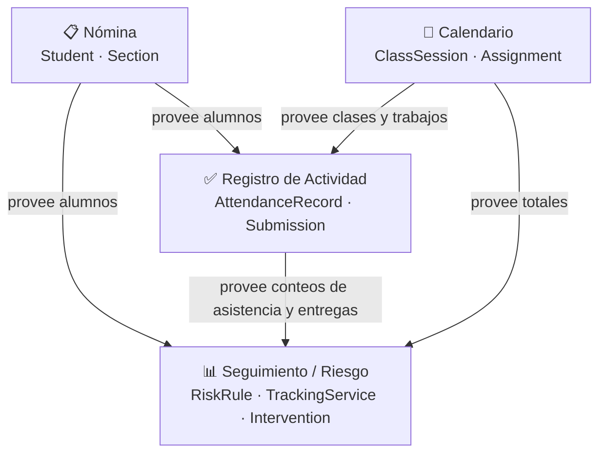

# Lenguaje Ubicuo — GestionEscolar

> **Propósito:** este documento es la fuente de verdad del Lenguaje Ubicuo (Ubiquitous Language) del dominio. Establece la terminología que usan los expertos del negocio, los desarrolladores y el código C#. Toda nueva nomenclatura debe acordarse aquí antes de escribirse en el código.

---

## 1. Glosario del Dominio

### Entidades

| Término (negocio) | Definición | Tipo DDD |
|---|---|---|
| **Comisión** | Grupo de cursado identificado por un nombre único (ej.: "Mañana - 1A"). Es el contexto raíz alrededor del cual se agrupan alumnos, clases y trabajos. | Entidad (raíz de agregado) |
| **Estudiante** | Persona matriculada en una comisión, identificada por DNI (clave natural) e `id` interno. Posee legajo, apellido, nombre, teléfono, e-mail y fecha de incorporación. | Entidad |
| **Clase** | Encuentro presencial de la comisión en una fecha concreta. La fecha la identifica dentro de la comisión (no se puede repetir). | Entidad |
| **Trabajo** | Trabajo práctico o entregable asociado a una comisión. Se identifica por nombre y fecha de vencimiento. | Entidad |
| **Registro de Asistencia** | Registro del estado de presencia de un Estudiante a una Clase concreta. Puede no existir si todavía no se cargó. | Entidad |
| **Entrega** | Registro del estado de entrega de un Estudiante para un Trabajo concreto. Puede no existir si todavía no se cargó. | Entidad |
| **Intervención** | Contacto registrado entre el docente y un alumno en riesgo. Guarda fecha, canal, resultado y nota opcional. | Entidad |

### Value Objects

| Término (negocio) | Definición | Tipo DDD |
|---|---|---|
| **Legajo** | Código alfanumérico único por comisión que identifica al estudiante dentro de la institución. Inmutable. | Value Object |
| **DNI** | Documento Nacional de Identidad; clave natural y primaria de la tabla `student`. Inmutable. | Value Object |
| **Porcentaje de Asistencia** | Proporción de clases a las que asistió el alumno respecto del total, redondeado alejándose de cero. Calculado, sin estado propio. | Value Object calculado |
| **Porcentaje de Entregas** | Proporción de trabajos entregados respecto del total. Calculado, sin estado propio. | Value Object calculado |
| **Puntaje de Riesgo** | Valor entero 0–100 que cuantifica el riesgo del alumno. Fórmula: 60 % inasistencia + 40 % entregas faltantes. | Value Object calculado |
| **Nivel de Riesgo** | Clasificación cualitativa derivada del Puntaje: **Bajo**, **Medio** o **Alto**. | Value Object (enum) |
| **Ítem de Calendario** | Vista unificada de una Clase o un Trabajo para la pantalla de Calendario. Tiene `Kind` (Clase / Trabajo), nombre opcional y fecha. | Value Object de proyección |
| **Marca de Asistencia** | Tupla *(alumno, estado de asistencia)* para una clase concreta, usada en la pantalla de registro masivo. | Value Object de proyección |
| **Marca de Entrega** | Tupla *(alumno, estado de entrega)* para un trabajo concreto, usada en la pantalla de registro masivo. | Value Object de proyección |
| **Configuración de Riesgo** | Umbrales en memoria (`HighThreshold` = 50, `MediumThreshold` = 25) que controlan la clasificación del nivel de riesgo. | Value Object de configuración |
| **Resumen de Riesgo** | Conteo de alumnos por nivel (Alto / Medio / Bajo + Total) para las tarjetas del panel de Seguimiento. | Value Object agregado |

### Agregados

| Raíz de agregado | Entidades incluidas | Descripción |
|---|---|---|
| **Comisión** (`Section`) | `Student`, `ClassSession`, `Assignment` | Toda la actividad académica de un grupo pertenece a una Comisión. Los Estudiantes no se mueven entre comisiones. |
| **Estudiante** (`Student`) | `AttendanceRecord`, `Submission`, `Intervention` | El historial personal del alumno (asistencias, entregas e intervenciones) es coherente solo dentro de la comisión. |

### Servicios de Dominio

| Servicio | Responsabilidad |
|---|---|
| **Regla de Riesgo** (`RiskRule`) | Cálculo puro del puntaje y la clasificación de riesgo a partir de conteos de asistencia y entregas. No guarda estado. Fórmula: 60 % inasistencia + 40 % entregas faltantes, redondeado alejándose de cero. |
| **Servicio de Seguimiento** (`TrackingService`) | Orquesta la consulta de filas crudas y la aplicación de `RiskRule` a cada alumno, devolviendo lista evaluada + resumen. Usa el `RiskConfig` singleton (actualizado por `RiskSettingsService`). |
| **Servicio de Asistencia** (`AttendanceService`) | Consulta las clases de la comisión, las marcas de asistencia y persiste cambios. Elige la clase por defecto (última hasta hoy, o la primera si todas son futuras). |
| **Servicio de Entregas** (`SubmissionService`) | Ídem para trabajos y entregas. `PickDefault` elige el último trabajo vencido hasta hoy, o el primero si todos son futuros. |
| **Servicio de Calendario** (`CalendarService`) | Combina y ordena clases y trabajos; valida reglas antes del alta (`CalendarEntryRules`: fecha única de clase, nombre obligatorio de trabajo máx. 120 caracteres). |
| **Servicio de Detalle del Alumno** (`StudentDetailsService`) | Ensambla la ficha completa (contacto + historial de asistencia, entregas e intervenciones) con tres consultas en paralelo. Valida y persiste el registro de contacto (`RegisterContactAsync`). |
| **Servicio de Nómina** (`StudentService`) | Devuelve la nómina de la comisión ordenada por apellido/nombre; da de alta un alumno a partir de un `StudentDraft`, verificando duplicados de legajo y DNI. |
| **Servicio de Comisiones** (`SectionService`) | Lista las comisiones y elige la de por defecto (Id 1 si existe, si no la primera). `PreferredDefaultId = 1`. |
| **Servicio de Configuración de Riesgo** (`RiskSettingsService`) | Lee y persiste los umbrales `HighThreshold`/`MediumThreshold` desde `dbo.setting`. Valida que sean 0–100 y que el umbral medio sea menor al alto. Actualiza el `RiskConfig` en memoria. Devuelve `RiskSettingsSaveResult(bool WasSaved, string Message)`. |

---

## 2. Mapeo a Código (C#)

### Modelos de dominio — `GestionEscolar.Core`

| Término (negocio) | Clase / Record C# | Namespace | Tabla SQL |
|---|---|---|---|
| Comisión | `Section` | `GestionEscolar.Core.Models` | `dbo.section` |
| Estudiante | `Student` | `GestionEscolar.Core.Models` | `dbo.student` |
| Borrador de alta de alumno | `StudentDraft` | `GestionEscolar.Core.Models` | *(DTO de entrada)* |
| Clase | `ClassSession` | `GestionEscolar.Core.Models` | `dbo.class_session` |
| Trabajo | `Assignment` | `GestionEscolar.Core.Models` | `dbo.assignment` |
| Registro de Asistencia | `AttendanceRecord` | `GestionEscolar.Core.Models` | `dbo.attendance_record` |
| Entrega | `Submission` | `GestionEscolar.Core.Models` | `dbo.submission` |
| Intervención / Contacto | `Intervention` | `GestionEscolar.Core.Models` | `dbo.intervention` |
| Ficha del Alumno | `StudentDetail` | `GestionEscolar.Core.Models` | *(proyección multi-tabla)* |
| Seguimiento de Alumno (datos crudos) | `StudentTrackingData` | `GestionEscolar.Core.Models` | *(proyección)* |
| Resultado de Riesgo del Alumno | `StudentRiskResult` | `GestionEscolar.Core.Models` | *(calculado)* |
| Seguimiento de Comisión | `SectionTracking` | `GestionEscolar.Core.Models` | *(calculado)* |
| Resumen de Riesgo | `RiskSummary` | `GestionEscolar.Core.Models` | *(calculado)* |
| Configuración de Riesgo | `RiskConfig` | `GestionEscolar.Core.Models` | `dbo.setting` |
| Ítem de Calendario | `CalendarItem` | `GestionEscolar.Core.Models` | *(proyección)* |
| Marca de Asistencia | `AttendanceMark` | `GestionEscolar.Core.Models` | *(proyección)* |
| Marca de Entrega | `SubmissionMark` | `GestionEscolar.Core.Models` | *(proyección)* |

### Enumeraciones — `GestionEscolar.Core.Enums`

| Término (negocio) | Enum C# | Valores |
|---|---|---|
| Nivel de Riesgo | `RiskLevel` | `Bajo`, `Medio`, `Alto` |
| Estado de Asistencia | `AttendanceStatus` | `Presente`, `Ausente` |
| Estado de Entrega | `SubmissionStatus` | `Entrego`, `NoEntrego` |
| Tipo de ítem del Calendario | `CalendarItemKind` | `Clase`, `Trabajo` |
| Canal de Contacto | `ContactChannel` | `Llamada`, `WhatsApp`, `Correo`, `Presencial` |
| Resultado de Contacto | `ContactOutcome` | `ComprometioVolver`, `SinNovedades`, `NoContesto`, `AbandonoConfirmado` |
| Mapeo a valores de BD | `DbStatusValues` (clase estática) | extensiones `ToDbValue` / `Parse*` |

### Interfaces de repositorio (puertos) — `GestionEscolar.Core.Interfaces`

| Puerto | Interfaz C# | Implementación (Data) |
|---|---|---|
| Seguimiento crudo | `ITrackingRepository` | `EfTrackingRepository` |
| Nómina | `IStudentRepository` | `EfStudentRepository` |
| Comisiones | `ISectionRepository` | `EfSectionRepository` |
| Detalle del alumno | `IStudentDetailsRepository` | `EfStudentDetailsRepository` |
| Resumen de riesgo | `IRiskSummaryRepository` | `EfRiskSummaryRepository` |
| Configuración de riesgo | `IRiskSettingsRepository` | `EfRiskSettingsRepository` |
| Calendario | `ICalendarRepository` | `EfCalendarRepository` |
| Asistencia | `IAttendanceRepository` | `EfAttendanceRepository` |
| Entregas | `ISubmissionRepository` | `EfSubmissionRepository` |

### Servicios de dominio — `GestionEscolar.Core.Services`

| Servicio de negocio | Clase C# |
|---|---|
| Regla de Riesgo | `RiskRule` (estático) |
| Seguimiento | `TrackingService` |
| Asistencia | `AttendanceService` |
| Entregas | `SubmissionService` |
| Calendario | `CalendarService` |
| Detalle del alumno | `StudentDetailsService` |
| Nómina | `StudentService` |
| Comisiones | `SectionService` |
| Configuración de Riesgo | `RiskSettingsService` |

### Tipos de soporte de la UI — `UI/`

| Tipo | Clase C# | Rol |
|---|---|---|
| Selección de comisión activa (singleton) | `SectionSelection` | Fuente de verdad de la comisión elegida en toda la sesión. Expone `Current`, `Items`, `Changed` (evento). Carga lazy con semáforo. Todos los `SectionScopedViewModel` se suscriben a `Changed`. |
| Fila de registro masivo (asistencia / entregas) | `StatusRow` | Observable; dispara el guardado automáticamente al cambiar el Picker del alumno. |
| Adaptador de fila de grilla | `StudentRow` | Adapta `Student` o `StudentRiskResult` para la grilla. Formatea nombre, iniciales, colores del badge de riesgo, texto de asistencia/entrega y justificación. |
| Ítem de Picker genérico | `PickerOption<T>` | Par `(T Value, string Label)` para bindear cualquier colección a un Picker MAUI. |
| Ítem del historial (detalle) | `HistoryItem` | Record `(string Label, string Status, string Kind)` para las listas de historial en `StudentDetailPage`. |
| Fila del Calendario | `CalendarRow` | Record `(string Name, string Kind, string DateText, string KindKey)` para la lista de ítems del calendario. |

### Servicios de UI — `UI/Services`

| Servicio | Clase C# | Rol |
|---|---|---|
| Selección de comisión | `SectionSelection` | Singleton compartido; carga las comisiones una sola vez y notifica cambios a todos los ViewModels suscriptos. |
| Importación de comisión | `CommissionImportService` | Servicio de UI de 3 pasos: lectura CSV → vista previa con resolución de conflictos → creación / aplicación. Usado por `CommissionImportViewModel`. |

| Tabla SQL | Clase EF (Data) |
|---|---|
| `dbo.section` | `SectionEntity` |
| `dbo.student` | `StudentEntity` |
| `dbo.class_session` | `ClassSessionEntity` |
| `dbo.assignment` | `AssignmentEntity` |
| `dbo.attendance_record` | `AttendanceRecordEntity` |
| `dbo.submission` | `SubmissionEntity` |
| `dbo.intervention` | `InterventionEntity` |
| `dbo.setting` | `SettingEntity` |

---

## 3. Acciones y Comandos del Dominio

Las acciones son los verbos principales que el dominio expone. En la UI se expresan como comandos MVVM (`[RelayCommand]`); en Core, como métodos async de servicio.

### Acciones sobre la Nómina

| Acción (negocio) | Método de servicio (Core) | Comando ViewModel (UI) | Pantalla |
|---|---|---|---|
| Ver nómina de la comisión | `StudentService.GetRosterAsync` | `LoadCommand` | `StudentListPage` |
| Dar de alta un alumno | `StudentService.AddAsync` | `AddStudentCommand` | `StudentListPage` |

### Acciones sobre el Seguimiento

| Acción (negocio) | Método de servicio (Core) | Comando ViewModel (UI) | Pantalla |
|---|---|---|---|
| Ver panel de seguimiento de la comisión | `TrackingService.GetSectionRiskAsync` | `LoadCommand` | `TrackingPage` |
| Filtrar por nivel de riesgo | *(filtro local en ViewModel)* | `FilterCommand` | `TrackingPage` |
| Ver detalle del alumno | *(navegación a ruta)* | `OpenDetailCommand` | `TrackingPage → StudentDetailPage` |
| Registrar contacto / intervención | `StudentDetailsService.RegisterContactAsync` | `RegisterContactCommand` | `StudentDetailPage` |

### Acciones sobre Asistencia

| Acción (negocio) | Método de servicio (Core) | Comando ViewModel (UI) | Pantalla |
|---|---|---|---|
| Ver asistencia de una clase | `AttendanceService.GetMarksAsync` | `LoadCommand` | `AttendancePage` |
| Cambiar asistencia de un alumno (upsert) | `AttendanceService.SaveAsync` | *(cambio en `StatusRow` Picker)* | `AttendancePage` |

### Acciones sobre Entregas

| Acción (negocio) | Método de servicio (Core) | Comando ViewModel (UI) | Pantalla |
|---|---|---|---|
| Ver entregas de un trabajo | `SubmissionService.GetMarksAsync` | `LoadCommand` | `SubmissionsPage` |
| Registrar entrega de un alumno (upsert) | `SubmissionService.SaveAsync` | *(cambio en `StatusRow` Picker)* | `SubmissionsPage` |

### Acciones sobre el Calendario

| Acción (negocio) | Método de servicio (Core) | Comando ViewModel (UI) | Pantalla |
|---|---|---|---|
| Ver calendario combinado | `CalendarService.GetItemsAsync` | `LoadCommand` | `CalendarPage` |
| Agregar clase | `CalendarService.AddClassAsync` | `AddClassCommand` | `CalendarPage` |
| Agregar trabajo | `CalendarService.AddAssignmentAsync` | `AddAssignmentCommand` | `CalendarPage` |

### Acciones de Configuración

| Acción (negocio) | Método / Interfaz (Core/Data) | Comando ViewModel (UI) | Pantalla |
|---|---|---|---|
| Ver umbrales de riesgo | `IRiskSettingsRepository.GetAsync` | `LoadCommand` | `SettingsViewPage` |
| Guardar umbrales de riesgo | `IRiskSettingsRepository.SaveAsync` | `SaveCommand` | `SettingsViewPage` |

---

## 4. Contextos Delimitados (Bounded Contexts)

La solución tiene un único proceso. Sin embargo, los módulos son suficientemente autónomos como para identificar cuatro Bounded Contexts lógicos:

### 4.1 Contexto: Gestión de Nómina

> Responsable de mantener el padrón de alumnos de la comisión.

**Términos clave:** Comisión, Estudiante, Legajo, DNI, Fecha de incorporación.

**Componentes:**
- Modelo: `Student`, `Section`
- Servicio: `StudentService`
- Puerto: `IStudentRepository`
- Adaptador: `EfStudentRepository`
- ViewModel: `StudentListViewModel`
- Vista: `StudentListPage`
- Tabla: `dbo.student`, `dbo.section`

---

### 4.2 Contexto: Seguimiento y Riesgo Académico

> Responsable de evaluar el estado académico de cada alumno y generar alertas de riesgo.

**Términos clave:** Puntaje de Riesgo, Nivel de Riesgo, Configuración de Riesgo, Resumen de Riesgo, Seguimiento de Comisión, Resultado de Riesgo del Alumno, Intervención.

**Componentes:**
- Modelos: `StudentTrackingData`, `StudentRiskResult`, `SectionTracking`, `RiskSummary`, `RiskConfig`, `StudentDetail`, `Intervention`
- Enums: `RiskLevel`, `ContactChannel`, `ContactOutcome`
- Servicios: `TrackingService`, `StudentDetailsService`, `SectionService`
- Regla pura: `RiskRule` (peso 60 % / 40 %)
- Puertos: `ITrackingRepository`, `IRiskSummaryRepository`, `IRiskSettingsRepository`, `IStudentDetailsRepository`, `ISectionRepository`
- Adaptadores: `EfTrackingRepository`, `EfRiskSummaryRepository`, `EfRiskSettingsRepository`, `EfStudentDetailsRepository`, `EfSectionRepository`
- ViewModels: `TrackingViewModel`, `StudentDetailViewModel`, `SettingsViewModel`
- Vistas: `TrackingPage`, `StudentDetailPage`, `SettingsViewPage`
- Tablas: `dbo.setting`, `dbo.intervention`, *(filas calculadas de)* `dbo.student`, `dbo.class_session`, `dbo.assignment`, `dbo.attendance_record`, `dbo.submission`

---

### 4.3 Contexto: Calendario Académico

> Responsable del calendario de clases y trabajos de la comisión.

**Términos clave:** Clase, Trabajo, Ítem de Calendario, Fecha de Clase, Fecha de Vencimiento.

**Componentes:**
- Modelos: `ClassSession`, `Assignment`, `CalendarItem`, `CalendarValidationException`
- Enum: `CalendarItemKind`
- Servicio: `CalendarService`
- Puerto: `ICalendarRepository`
- Adaptador: `EfCalendarRepository`
- ViewModel: `CalendarViewModel`
- Vista: `CalendarPage`
- Tablas: `dbo.class_session`, `dbo.assignment`
- **Regla de integridad:** no se puede repetir la fecha de una clase en la misma comisión (`uq_class_session_section_date`); el nombre del trabajo es obligatorio (máx. 120 caracteres).

---

### 4.4 Contexto: Registro de Actividad

> Responsable del registro diario de asistencia y entregas de cada alumno.

**Términos clave:** Registro de Asistencia, Entrega, Marca de Asistencia, Marca de Entrega, Estado de Asistencia, Estado de Entrega.

**Componentes:**
- Modelos: `AttendanceRecord`, `Submission`, `AttendanceMark`, `SubmissionMark`
- Enums: `AttendanceStatus`, `SubmissionStatus`
- Traductor de estados: `DbStatusValues` (`presente` / `ausente`, `entregó` / `no entregó`)
- Servicios: `AttendanceService`, `SubmissionService`
- Puertos: `IAttendanceRepository`, `ISubmissionRepository`
- Adaptadores: `EfAttendanceRepository`, `EfSubmissionRepository`
- ViewModels: `AttendanceViewModel`, `SubmissionsViewModel`
- Vistas: `AttendancePage`, `SubmissionsPage`
- Tablas: `dbo.attendance_record`, `dbo.submission`
- **Regla de integridad:** upsert por `(class_session_id, student_id)` y `(assignment_id, student_id)`; solo se acepta si el alumno pertenece a la comisión; una corrección actualiza `corrected_at`.

---

## 5. Diagrama de dependencias entre Contextos

---

## 6. Invariantes y Reglas del Dominio

| Regla | Ubicación en código |
|---|---|
| La fecha de una clase no puede repetirse en la misma comisión. | `CalendarService.AddClassAsync` + `uq_class_session_section_date` |
| El nombre de un trabajo es obligatorio y tiene un máximo de 120 caracteres. | `CalendarEntryRules.AssignmentName` |
| El puntaje de riesgo se calcula como 60 % de inasistencia + 40 % de entregas faltantes, redondeado alejándose de cero. | `RiskRule.Score` |
| El nivel de riesgo se clasifica con umbrales configurables: ≥ 50 → Alto, ≥ 25 → Medio, < 25 → Bajo (valores por defecto). | `RiskRule.Classify` + `RiskConfig` |
| Los estados de asistencia y entrega solo pueden tomar valores controlados (`presente`/`ausente`, `entregó`/`no entregó`). | `DbStatusValues` + CHECK constraints en BD |
| Un alumno no puede tener dos legajos distintos en la misma comisión ni dos registros con el mismo DNI en el sistema. | `StudentService.AddAsync` + `uq_student_section_student_number` |
| La fecha de un contacto no puede ser posterior al día de hoy. | `StudentDetailsService.RegisterContactAsync` |
| Los umbrales de riesgo son valores enteros entre 0 y 100. | `ck_setting_value` en `dbo.setting` |

---

*Generado el 2026-10-30. Mantener sincronizado con los cambios en `GestionEscolar.Core` y `GestionEscolar.Data`.*

