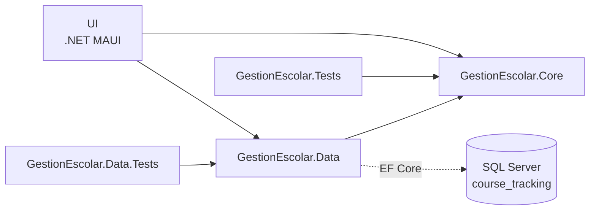
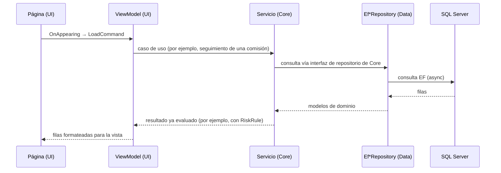

# Arquitectura de GestionEscolar

Este documento describe la arquitectura **actual** de la solución `GestionEscolar.slnx`: qué proyectos hay, qué hace cada uno, cómo se conectan y qué deuda técnica quedó identificada.

Documentos relacionados (en la raíz del repo `PP2/`):

- [`README.md`](../README.md): modelo de dominio y git hooks.
- [`AGENTS.md`](../AGENTS.md): mapa breve para agentes de IA, en inglés.
- [`docs/index.md`](../docs/index.md): índice de la documentación detallada (build, convenciones, harness).
- [`AI_USAGE.md`](../AI_USAGE.md): uso de IA y skills recomendados.

Diagrama de capas: [`gestionescolar-arquitectura.svg`](../gestionescolar-arquitectura.svg).

## 1. Visión general

La solución sigue una variante simple de **Clean Architecture** (también llamada "Onion" o "Ports & Adapters") con tres capas:

- **Core**: dominio y casos de uso. No depende de MAUI, SQL ni Entity Framework. Solo referencia las abstracciones de DI para exponer el alta de sus servicios.
- **Data**: infraestructura. Implementa en SQL Server las interfaces de repositorio que define Core.
- **UI**: presentación (.NET MAUI, MVVM). Consume los casos de uso de Core y cablea todo en `MauiProgram`.

Las dependencias apuntan siempre hacia Core.

| Proyecto | Tipo | Target |
|---|---|---|
| `GestionEscolar.Core` | Class library | `net10.0` |
| `GestionEscolar.Data` | Class library (Entity Framework Core SQL Server) | `net10.0` |
| `UI` | App .NET MAUI (MVVM con CommunityToolkit.Mvvm) | `net10.0-windows10.0.19041.0` (el `.csproj` también declara android, ios y maccatalyst) |
| `GestionEscolar.Tests` | xUnit sobre Core, con repositorios falsos | `net10.0` |
| `GestionEscolar.Data.Tests` | xUnit sobre los repositorios EF, contra SQL Server Express | `net10.0` |

### Estructura

```
PP2/
├─ .husky/                     hooks de git (Husky.Net) + task-runner.json
├─ dotnet-tools.json           herramientas locales (husky, dotnet-ef)
├─ scripts/                    run-tests, run-database, run-desktop, hooks/pre-push.cmd
├─ README.md · AGENTS.md · AI_USAGE.md · docs/
└─ GestionEscolar/
   ├─ GestionEscolar.slnx · ARCHITECTURE.md
   ├─ GestionEscolar.Core/     Enums/ Interfaces/ Models/ Services/
   ├─ GestionEscolar.Data/     Persistence/ Repositories/ Migrations/ Database/Migrations/ (0001–0010)
   ├─ UI/                      Views/ ViewModels/ Controls/ Services/ Formatting/ Converters/ MauiProgram.cs
   ├─ GestionEscolar.Tests/    Fakes/ Services/
   └─ GestionEscolar.Data.Tests/
```

### Dependencias entre proyectos



`UI` referencia a `Data` solo para llamar `AddGestionEscolarData()` al arrancar. Del resto de la solución, la UI solo usa Core.

## 2. Rol de cada proyecto

### 2.1 `GestionEscolar.Core`: dominio y casos de uso

Lógica pura: no conoce MAUI, SQL ni Entity Framework. Por eso se testea directamente desde un proyecto `net10.0`.

- **`Models/`**: entidades, resultados y reglas de validación del dominio, sin formato de UI.
- **`Enums/`**: estados y niveles del dominio. `DbStatusValues` es el único lugar que traduce enums a los valores exactos de la base.
- **`Interfaces/`**: los repositorios (puertos) que implementa Data. Los usan los servicios de Core.
- **`Services/`**: los casos de uso. Cada uno tiene su interfaz (`I*Service`), que es lo que consume la UI.
  - Seguimiento de riesgo: `TrackingService` y `RiskRule`, el cálculo puro del puntaje y el nivel.
  - Alumnos: `StudentsQueryService` (consulta con filtros y paginado), `StudentService`, `StudentDetailsService`.
  - Comisiones: `SectionService`.
  - Calendario, asistencia y entregas: `CalendarService`, `AttendanceService`, `SubmissionService`.
  - Importación de CSV: `CommissionImportService` y lectores de CSV.
  - Reportes: `ReportService`.
  - Ajustes: `RiskSettingsService`, que lee y guarda los umbrales de riesgo.
- **`CoreServiceCollectionExtensions`**: `AddGestionEscolarCore()` registra los servicios como transient y `RiskConfig` (umbrales en memoria) como singleton.

### 2.2 `GestionEscolar.Data`: infraestructura

Acceso a SQL Server con Entity Framework Core. Implementa las interfaces de repositorio de Core. Cada operación abre un `CourseTrackingDbContext` desde una fábrica de contextos y lo cierra al terminar. Las entidades de `Persistence/` se traducen a los modelos de dominio dentro del repositorio, así que Core no conoce el ORM.

- **`Persistence/`**: `CourseTrackingDbContext` y sus entidades (tablas `section`, `student`, `class_session`, `assignment`, `attendance_record`, `submission`, `intervention`, `setting`).
- **`Repositories/`**: una implementación `Ef*Repository` por cada interfaz de Core.
- **`DatabaseOptions` y `DatabaseInstance`**: la connection string leída de la configuración y la fábrica de conexiones.
- **`DataServiceCollectionExtensions`**: `AddGestionEscolarData(configuration)` registra la conexión y los repositorios como singleton.
- **`Migrations/`**: migraciones de EF Core. Todo cambio de esquema nuevo sale de acá.
- **`Database/Migrations/`**: scripts SQL históricos `0001`–`0010` (base, tablas y datos de prueba). No se editan.

### 2.3 `UI`: presentación (.NET MAUI + MVVM)

- **`AppShell`**: Shell con barra lateral fija. Las pantallas son Estudiantes, Calendario, Reportes y Ajustes. `StudentDetailPage` se registra como ruta. Shell resuelve las páginas por DI.
- **`Views/`**: páginas XAML. El code-behind se limita a lógica visual y navegación.
- **`ViewModels/`**: hablan solo con los servicios de Core, nunca con un repositorio. Usan `[ObservableProperty]` y `[RelayCommand]`.
- **`Controls/`**: controles reutilizables (barra lateral, tarjetas, filtros, selector de comisión, skeletons de carga).
- **`Services/`**: costuras propias de la UI: `SectionSelection` (comisión compartida por todas las pantallas, singleton), `IClock`, `ICsvFileSource`, `IAppNavigation` y `IReportShareService`.
- **`Formatting/` y `Converters/`**: formato y colores de presentación.
- **`MauiProgram.cs`**: *composition root*.
  - Carga `appsettings.json` embebido.
  - Llama `AddGestionEscolarCore()` y `AddGestionEscolarData(configuration)`.
  - Registra las costuras de UI, los ViewModels y las páginas.

### 2.4 Tests

- **`GestionEscolar.Tests`**: xUnit sobre Core, sin base de datos. `Fakes/` tiene repositorios en memoria y `Services/` los tests de los casos de uso.
- **`GestionEscolar.Data.Tests`**: xUnit sobre los repositorios EF y el esquema, contra SQL Server Express. Usa bases propias de test y no toca `course_tracking`.

Ningún proyecto de test referencia la UI.

## 3. Flujo de ejemplo: una pantalla que lee datos



1. La página dispara el comando de carga en `OnAppearing`. Nada toca la base en el constructor.
2. El ViewModel activa `IsBusy` y llama a un servicio de Core. No recibe repositorios.
3. El servicio pide los datos a través de la interfaz de repositorio. En runtime la implementa Data.
4. El servicio aplica las reglas del dominio (por ejemplo, `RiskRule`) y devuelve modelos sin formato.
5. El ViewModel da formato y filtra para la vista.

Si la base no responde, se registra el error y la pantalla muestra el estado de error sin romper el Shell.

## 4. Convenciones

- **Las dependencias apuntan hacia Core.** Core no referencia a Data ni a UI. Las interfaces se definen en Core y se implementan afuera.
- **Sin SQL en ViewModels, Views ni Core.** Todo acceso a datos pasa por un repositorio de `GestionEscolar.Data`.
- **Los ViewModels no reciben repositorios**, solo servicios de Core y ayudantes de UI.
- **Async para I/O.** Los repositorios usan Entity Framework con un contexto por operación y sin SQL concatenado. Los ViewModels exponen comandos async con `IsBusy`.
- **Enums en lugar de strings mágicos.** Los valores de la base se traducen solo en `DbStatusValues`.
- **Connection string en un único lugar.** Se lee de `UI/appsettings.json` (`ConnectionStrings:CourseTracking`) y `DatabaseOptions` la lleva a la infraestructura.
- **Modelos de Core sin formato de UI.** El formato vive en `UI/Formatting` y en los ViewModels.
- **Inyección por constructor.** Repositorios singleton; servicios, ViewModels y páginas transient. Excepción: `SectionSelection`, singleton de UI.
- **Archivos `.cs` en UTF-8 con BOM.**
- **Textos de la UI en español.**
- **Cambios de esquema:** una migración nueva de EF en `GestionEscolar.Data/Migrations`, aplicada con `dotnet tool run dotnet-ef database update`. No se editan las migraciones ya aplicadas ni los scripts `0001`–`0010`.

## 5. Scripts (`PP2/scripts/`) y hooks

| Script | Qué hace |
|---|---|
| `run-tests.cmd` | Ejecuta `dotnet test` sobre todos los `*.Tests.csproj` de la solución (acepta argumentos extra). |
| `run-database.cmd` | Ejecuta con `sqlcmd` los scripts históricos `0001`–`0010`. No aplica el DDL nuevo: eso lo hace EF. |
| `run-desktop.cmd` | Cierra `UI.exe` si está abierto y ejecuta la app (target Windows). |
| `hooks/pre-push.cmd` | Lo usa el hook pre-push: compila la UI y corre los tests. Si `UI.exe` está abierto, avisa y corta. |

Para compilar la UI en Windows: `dotnet build UI\UI.csproj -f net10.0-windows10.0.19041.0`. Si `UI.exe` está abierto, la copia del ejecutable falla.

Los git hooks (Husky.Net) se configuran en `.husky/task-runner.json`. Hoy ese archivo define la tarea `pre-push`. Se instalan solos al restaurar o compilar. Detalles y `--no-verify`: ver [`README.md`](../README.md) y [`docs/build-and-test.md`](../docs/build-and-test.md).

## 6. Pendientes y deuda conocida

- **Tests de arquitectura**: `AGENTS.md` y `docs/harness.md` hablan de `GestionEscolar.Architecture.Tests` (ArchUnitNET), pero esa carpeta hoy no tiene código ni figura en `GestionEscolar.slnx`. Las reglas de capas están documentadas y se revisan a mano.
- **`vw_student_risk` no se usa.** El puntaje lo calcula `RiskRule` en Core; la vista queda fuera del modelo de EF.
- **Scripts históricos `0001`–`0010`**: mezclan DDL y datos de prueba, y `run-database.cmd` no se puede re-ejecutar sobre una base con datos. El DDL nuevo lo aplica EF.
- **Código sin uso**: `UI/Seeding/StudentSeeder` y `sample.csv` no los usa ningún ViewModel.
- **Detalle del alumno y Calendario**: revisar las acciones que todavía no están completas (alta de contacto, edición y borrado de clases y trabajos) contra el backlog de tickets.

## 7. Fuentes

- **Microsoft Learn: Common web application architectures (Clean Architecture)**
  https://learn.microsoft.com/en-us/dotnet/architecture/modern-web-apps-azure/common-web-application-architectures
  Base de la separación Core / Infrastructure / UI: dependencias hacia el núcleo, interfaces en Core implementadas en infraestructura y la UI como *composition root*.

- **Microsoft Learn: Model-View-ViewModel (Enterprise Application Patterns Using .NET MAUI)**
  https://learn.microsoft.com/en-us/dotnet/architecture/maui/mvvm
  Reparto View / ViewModel / Model, code-behind mínimo y operaciones async en el ViewModel.

- **Microsoft Learn: Dependency injection in .NET MAUI**
  https://learn.microsoft.com/en-us/dotnet/maui/fundamentals/dependency-injection
  Registro en `MauiProgram.CreateMauiApp`, resolución de páginas en Shell y `AddTransient` / `AddSingleton`.

- **Martin Fowler: Repository (Patterns of Enterprise Application Architecture)**
  https://martinfowler.com/eaaCatalog/repository.html
  Definición del patrón Repository, con dependencia en un solo sentido.

- **Microsoft Learn: Designing the infrastructure persistence layer (DDD / microservicios)**
  https://learn.microsoft.com/en-us/dotnet/architecture/microservices/microservice-ddd-cqrs-patterns/infrastructure-persistence-layer-design
  Por qué las interfaces de repositorio van en el dominio y la implementación en infraestructura, y cómo eso permite tests con repositorios falsos.
