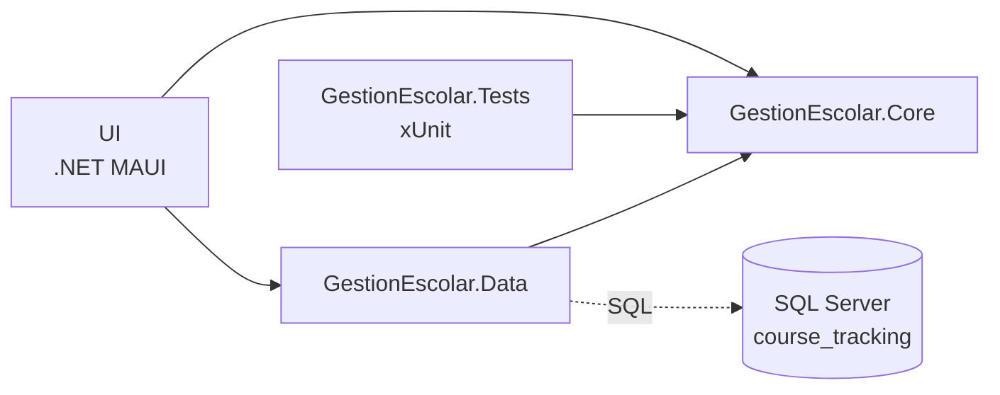
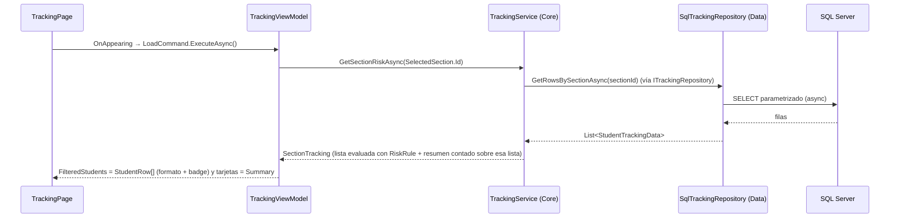
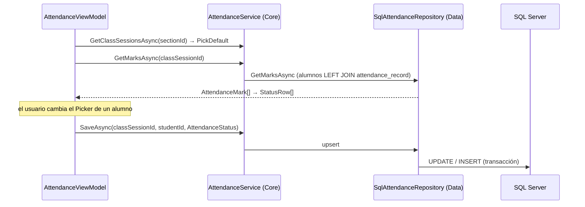

# Arquitectura de GestionEscolar

Este documento describe la arquitectura **actual** de la solución `GestionEscolar.slnx`: qué proyectos hay, qué hace cada uno, cómo se conectan y qué deuda técnica quedó identificada.

Documentos relacionados (en la raíz del repo `PP2/`):

- [`README.md`](../README.md): modelo de dominio y git hooks.
- [`AGENTS.md`](../AGENTS.md): instrucciones para agentes de IA, en inglés.
- [`AI_USAGE.md.md`](../AI_USAGE.md.md): uso de IA y skills recomendados.

## 1. Visión general

La solución sigue una variante simple de **Clean Architecture** (también llamada "Onion" o "Ports & Adapters"):

- La lógica de negocio vive en un proyecto central (`GestionEscolar.Core`) que no depende de MAUI ni de SQL. Solo referencia las abstracciones de DI para exponer el alta de sus casos de uso.
- La infraestructura (`GestionEscolar.Data`) y la presentación (`UI`) dependen de Core, y no al revés.

| Proyecto | Tipo | Target |
|---|---|---|
| `GestionEscolar.Core` | Class library | `net10.0` |
| `GestionEscolar.Data` | Class library (+ `Microsoft.Data.SqlClient` 7.1.1) | `net10.0` |
| `UI` | App .NET MAUI (MVVM con CommunityToolkit.Mvvm) | `net10.0-windows10.0.19041.0`, `-android`, `-ios`, `-maccatalyst` |
| `GestionEscolar.Tests` | xUnit | `net10.0` |

### Estructura

```
PP2/
├─ .husky/                     hooks de git (Husky.Net) + task-runner.json
├─ dotnet-tools.json           herramientas locales (husky)
├─ scripts/                    run-tests, run-database, run-desktop, hooks/pre-push.cmd
├─ README.md · AGENTS.md · AI_USAGE.md.md
└─ GestionEscolar/
   ├─ GestionEscolar.slnx · ARCHITECTURE.md
   ├─ GestionEscolar.Core/     Enums/ Interfaces/ Models/ Services/
   ├─ GestionEscolar.Data/     DatabaseInstance, DatabaseOptions, Repositories/, Database/Migrations/
   ├─ UI/                      Views/ ViewModels/ Converters/ Seeding/ AppShell.xaml MauiProgram.cs
   └─ GestionEscolar.Tests/    Fakes/ Services/
```

### Dependencias entre proyectos



Todas las flechas de proyecto apuntan hacia Core. `UI` referencia a `Data` para llamar el alta de infraestructura. Core y Data exponen ese alta; la UI registra ViewModels y páginas.

## 2. Rol de cada proyecto

### 2.1 `GestionEscolar.Core`: dominio

Lógica pura: **no conoce MAUI ni SQL**. Por eso se puede testear directamente desde un proyecto `net10.0`.

- **`Models/`**: datos sin formato de UI.
  - `Student`: datos del alumno para la Nómina (Id, nombre, legajo, teléfono, email).
  - `StudentTrackingData`: asistencia, entregas y último contacto de un alumno en una comisión, con `AttendancePercent` y `DeliveryPercent`.
  - `StudentRiskResult`: `StudentTrackingData` + `RiskScore` + `RiskLevel` (+ `Score` = 100 − riesgo).
  - `StudentDetail`, `AttendanceRecord`, `Submission`, `Intervention`: ficha del alumno y sus historiales (estado `null` = sin registro).
  - `Section`: comisión (`Id`, `Name`) de `dbo.section`.
  - `ClassSession` (clase: comisión + fecha) y `Assignment` (trabajo: comisión + nombre + vencimiento).
  - `CalendarItem`: ítem de la lista combinada del Calendario. Su `Kind` es un `CalendarItemKind` y su `Name` es `null` en las clases.
  - `AttendanceMark` / `SubmissionMark`: alumno ("Apellido, Nombre") + estado para una clase o un trabajo (`null` = sin registro).
  - `CalendarValidationException`: error de validación con un mensaje listo para mostrar.
  - `RiskSummary`: cantidad de alumnos Alto/Medio/Bajo (+ `Total`) de una comisión. `RiskSummary.FromResults` cuenta a partir de la lista ya evaluada. `SectionTracking` junta esa lista y el resumen.
  - `RiskConfig`: umbrales de riesgo (`HighThreshold` = 50, `MediumThreshold` = 25).
- **`Enums/`**:
  - `RiskLevel` (Bajo/Medio/Alto), `AttendanceStatus`, `SubmissionStatus` y `CalendarItemKind` (Clase/Trabajo).
  - `DbStatusValues`, que traduce los enums a los valores exactos de la base (`presente`, `entregó`, etc.).
- **`Interfaces/`**: los "puertos" que implementa Data.
  - `ITrackingRepository` (`GetRowsBySectionAsync`).
  - `IRiskSummaryRepository` (`GetSummaryBySectionAsync`).
  - `ISectionRepository` (`GetAllAsync`).
  - `IStudentDetailsRepository`: contacto, asistencia, entregas e intervenciones de un alumno.
  - `IStudentRepository` (`GetRosterAsync`).
  - `ICalendarRepository`: clases y trabajos de una comisión, y sus altas.
  - `IAttendanceRepository` / `ISubmissionRepository`: estado por alumno y upsert.
- **`Services/`**:
  - `RiskRule`: cálculo puro. Asistencias, entregas, totales y umbrales entran juntos y devuelven puntaje y nivel (60 % inasistencia, 40 % entregas faltantes, redondeo alejándose de cero).
  - `TrackingService`: pide las filas al repositorio, evalúa cada alumno con `RiskRule` y devuelve un `SectionTracking` (lista + resumen contado sobre esa lista).
  - `StudentDetailsService`: arma el `StudentDetail` (contacto + historiales de la comisión) desde `IStudentDetailsRepository`.
  - `StudentService`: nómina de una comisión (`GetRosterAsync`).
  - `SectionService`: lista las comisiones y elige la de por defecto (`PickDefault`: la 1 si existe, si no la primera).
  - `CalendarService`:
    - devuelve la lista combinada ordenada por fecha;
    - `AddClassAsync` consulta `CalendarEntryRules` y no acepta una fecha de clase repetida en la comisión;
    - `AddAssignmentAsync` consulta `CalendarEntryRules`: exige nombre (se recorta, máx. 120) y guarda la fecha sin hora.
  - `AttendanceService` / `SubmissionService`: clases o trabajos de la comisión, estado por alumno y guardado. `PickDefault` elige la última fecha hasta hoy.
  - `CsvParser` y `StudentCsvImporter`: lectura de CSV.

### 2.2 `GestionEscolar.Data`: infraestructura

Acceso a SQL Server. Implementa las interfaces de Core con SQL parametrizado y async.

- `DatabaseOptions`: transporta la connection string leída de la configuración (`ConnectionStrings:CourseTracking` en `UI/appsettings.json`).
- `DatabaseInstance`: fábrica de conexiones (`GetConnection`, `OpenConnectionAsync`), más `TestConnection(Async)` y `ListTables(Async)`. Es singleton por DI, no por un `GetInstance` estático.
- **`Repositories/`**:
  - `SqlTrackingRepository`: implementa `ITrackingRepository` con subconsultas sobre `class_session`, `attendance_record`, `assignment`, `submission` e `intervention`. Solo devuelve datos; no calcula riesgo.
  - `SqlStudentDetailsRepository`: datos del alumno y su comisión, más:
    - clases de la comisión con `LEFT JOIN` a `attendance_record`;
    - trabajos con `LEFT JOIN` a `submission`;
    - intervenciones.

    Los estados se traducen con `DbStatusValues.Parse*`.
  - `SqlStudentRepository`: nómina de una comisión desde `dbo.student`, ordenada por apellido.
  - `SqlSectionRepository`: `SELECT id, name FROM dbo.section`.
  - `SqlRiskSummaryRepository`: implementa `IRiskSummaryRepository`.
    - Sigue en el código y en el alta de Data, pero **la pantalla de Seguimiento no lo llama**: las tarjetas salen de `SectionTracking.Summary`.
    - Cuenta los niveles directamente en SQL **replicando la fórmula de `RiskRule`**: FLOAT + `ROUND` half away from zero, y asistencias/entregas recortadas al total.
    - Recibe los umbrales de `RiskConfig` como parámetros.
    - No usa `vw_student_risk`, porque esa vista calcula sobre los registros del alumno y no sobre los totales de la comisión.
  - `SqlCalendarRepository`:
    - lectura e `INSERT ... OUTPUT INSERTED.id` en `class_session` / `assignment`;
    - traduce la violación de la UNIQUE (2627/2601) de una clase repetida a `CalendarValidationException`.
  - `SqlAttendanceRepository` / `SqlSubmissionRepository`:
    - listan todos los alumnos de la comisión con `LEFT JOIN` al registro;
    - guardan con upsert (`UPDATE` / `INSERT` en una transacción con `UPDLOCK, SERIALIZABLE`) sobre las UNIQUE `(class_session_id, student_id)` y `(assignment_id, student_id)`;
    - solo insertan si el alumno es de la comisión;
    - al corregir una asistencia existente se setea `corrected_at`.
- `Database/Migrations/*.up.sql`: migraciones 0001–0010.
  - Crean la base `course_tracking`, las tablas, `dbo.setting` con sus valores iniciales, la vista `vw_student_risk` y datos de prueba.
  - No se compilan; las ejecuta `run-database.cmd`.

### 2.3 `UI`: presentación (.NET MAUI + MVVM)

- **Shell** (`AppShell.xaml`). Flyout, en este orden:

  | Título | Página | Ruta |
  |---|---|---|
  | Nómina | `StudentListPage` | — |
  | Seguimiento | `TrackingPage` | — |
  | Entregas | `SubmissionsPage` | `Submissions` |
  | Asistencia | `AttendancePage` | `Attendance` |
  | Calendario | `CalendarPage` | `Calendar` |
  | Ajustes | `SettingsViewPage` | — |
  | Home | `MainPage` | — |

  `StudentDetailPage` se registra como ruta con `Routing.RegisterRoute` (`AppShell.xaml.cs`).
- **Views** (`Views/*.xaml`): el code-behind se limita a lógica visual, navegación y ejecutar `LoadCommand` en `OnAppearing`.
- **ViewModels** (`ViewModels/`):
  - `TrackingViewModel`, `StudentDetailViewModel`, `StudentListViewModel`, `SettingsViewModel`.
  - `AttendanceViewModel`, `SubmissionsViewModel`, `CalendarViewModel`, que heredan de `SectionScopedViewModel`.
  - Usan `[ObservableProperty]` y `[RelayCommand]`.
- **`SectionScopedViewModel`**: base con el selector de comisión.
  - Carga las comisiones una sola vez y elige la de por defecto sin recargar dos veces.
  - Serializa las cargas con `IsBusy`.
  - Expone `ErrorMessage` / `StatusMessage`.
- **`StatusRow`**: fila "alumno + Picker de estado" de Asistencia y Entregas. Cambiar el estado dispara el guardado.
- **`PickerOption<T>`**: ítem de Picker con texto ya formateado (`dd/MM/yyyy`, `Nombre · dd/MM/yyyy`).
- **`StudentRow`**: fila de grilla para Nómina y Seguimiento. Concentra todo el formato (`LegajoLabel`, `AttendanceText`, `DeliveryText`, `ContactLabel`, `Justification`, colores del badge).
- **`RiskBadge`**: colores por `RiskLevel`, compartidos entre Seguimiento y Detalle.
- **`Converters/InvertBoolConverter`**: deshabilita los Pickers mientras `IsBusy`.
- **`MauiProgram.cs`**: *composition root*.
  - Carga `appsettings.json` embebido en la configuración de la app.
  - Llama `AddGestionEscolarCore()` (casos de uso transient y `RiskConfig` singleton, 50/25) y `AddGestionEscolarData(configuration)` (conexión y repositorios singleton).
  - La UI sigue registrando ViewModels y páginas como transient.
  - Shell resuelve las páginas por DI, y cada página recibe su ViewModel por constructor.
- `Seeding/StudentSeeder` + `sample.csv` (recurso embebido): lector del CSV de alumnos. Hoy ningún ViewModel lo usa, porque Nómina lee de SQL.

### 2.4 `GestionEscolar.Tests`

xUnit sobre Core, sin base de datos:

- **`Fakes/`**: implementaciones en memoria.
  - `FakeTrackingRepository`, `FakeSectionRepository`, `FakeStudentRepository`, `FakeStudentDetailsRepository`, `FakeCalendarRepository`.
  - `FakeAttendanceRepository` / `FakeSubmissionRepository`, en `FakeMarksRepositories.cs`.
- **`Services/`**: `TrackingServiceTests`, `RiskRuleTests`, `RiskSummaryTests`, `SectionServiceTests`, `StudentDetailsServiceTests`, `StudentServiceTests`, `CalendarServiceTests`, `AttendanceAndSubmissionServiceTests`, `CsvParserTests`, `StudentCsvImporterTests` y `CoreRegistrationTests`.

## 3. Flujo de ejemplo: Panel de Seguimiento



1. `TrackingPage.OnAppearing` ejecuta `LoadCommand`.
   - La primera vez carga las comisiones (`SectionService`) para el `Picker` del encabezado y selecciona la de por defecto sin disparar una recarga extra.
   - Cambiar la comisión en el selector recarga la grilla y las tarjetas para ese `sectionId`. Si llega un cambio mientras `IsBusy`, se recarga al terminar.
   - No se toca la base en el constructor.
2. `TrackingViewModel.LoadAsync` activa `IsBusy` y pide un solo `SectionTracking` a `TrackingService`. La grilla y las tarjetas salen de ese resultado. El ViewModel no recibe un repositorio.
3. `TrackingService` obtiene los datos a través de `ITrackingRepository`; en runtime, la implementación es `SqlTrackingRepository`.
4. Para cada alumno calcula `RiskScore` y `RiskLevel` con `RiskRule`. El resumen cuenta esos niveles.
5. El ViewModel aplica filtros (nivel de riesgo, "sin contactar") y crea un `StudentRow` por fila.
6. Al tocar una fila, se navega a `StudentDetailPage`.
   - Se pasa el `StudentRow` con la clave `"Student"`, además de `SectionId` y `SectionName`.
   - `StudentDetailViewModel` muestra el riesgo de la fila (igual que la grilla).
   - Carga el contacto y los historiales con `StudentDetailsService`, con `IsBusy`, estados vacíos y error.

Si la base no responde, se loguea el error, `ErrorMessage` toma un valor y la grilla queda vacía, sin romper el Shell.

## 3.1 Asistencia, Entregas y Calendario

Las tres pantallas comparten `SectionScopedViewModel`.

| Pantalla | ViewModel | Servicio (Core) | Repositorio (Data) | Tablas |
|---|---|---|---|---|
| Asistencia | `AttendanceViewModel` | `AttendanceService` | `SqlAttendanceRepository` + `SqlCalendarRepository` | `class_session`, `attendance_record` |
| Entregas | `SubmissionsViewModel` | `SubmissionService` | `SqlSubmissionRepository` + `SqlCalendarRepository` | `assignment`, `submission` |
| Calendario | `CalendarViewModel` | `CalendarService` | `SqlCalendarRepository` | `class_session`, `assignment` |



- **Asistencia y Entregas:**
  - Picker de clase (`dd/MM/yyyy`) o de trabajo (`Nombre · dd/MM/yyyy`). Por defecto, la última fecha hasta hoy.
  - Cada alumno (`Apellido, Nombre`) tiene un Picker. Al cambiarlo se guarda en el momento.
  - Sin registro = Picker vacío ("Sin registro").
- **Calendario:**
  - Alta de Clase: solo fecha; no se repite por comisión.
  - Alta de Trabajo: nombre obligatorio, máx. 120.
  - Lista combinada ordenada por fecha.
- **Nómina** (`StudentListViewModel`): lista los alumnos con `StudentService` → `SqlStudentRepository`.

## 4. Convenciones

- **Las dependencias apuntan hacia Core.** Core no referencia a Data ni a UI. Las interfaces se definen en Core y se implementan afuera.
- **Sin SQL en ViewModels ni en Views.** Todo acceso a datos pasa por un repositorio en `GestionEscolar.Data`.
- **Async para I/O.**
  - Los repositorios usan `OpenAsync`, `ExecuteReaderAsync` y `ReadAsync`, con parámetros tipados (nunca SQL concatenado).
  - Los ViewModels exponen comandos async con `IsBusy`.
- **Enums en lugar de strings mágicos.** Se usa `RiskLevel` en lugar de "Alto"/"Medio"/"Bajo", y los valores de la base salen de `DbStatusValues.ToDbValue()`.
- **Connection string en un único lugar.** Se lee de `appsettings.json` (`ConnectionStrings:CourseTracking`) y `DatabaseOptions` la lleva a la infraestructura. Una cadena vacía impide construir la conexión.
- **Modelos de Core sin formato de UI.** El formato vive en `StudentRow`, `RiskBadge`, `PickerOption` y los ViewModels.
- **Inyección por constructor.** Nada de `new ViewModel()` en las páginas ni singletons estáticos.
- **Archivos `.cs` en UTF-8 con BOM.**
- **Textos de la UI en español.**
- **Cambios de esquema:** una migración nueva numerada; no se editan las ya aplicadas.

## 5. Scripts (`PP2/scripts/`) y hooks

| Script | Qué hace |
|---|---|
| `run-tests.cmd` | Recorre todos los `*.Tests.csproj` de la solución y ejecuta `dotnet test` (acepta argumentos extra). Termina con `[SUCCESS]` o `[ERROR]`. |
| `run-database.cmd` | Ejecuta con `sqlcmd` contra `.\SQLEXPRESS` todas las migraciones de `GestionEscolar.Data\Database\Migrations\*.up.sql` en orden. Ya **no borra nada**: los `DROP DATABASE` / `DROP TABLE` de las migraciones están comentados hasta separar los scripts DDL de los DML. Con el servidor vacío crea `course_tracking`, carga los datos de prueba y lista las tablas. Sobre una base existente, las tablas se saltean (`IF OBJECT_ID(...) IS NULL`), pero el seed de `0010` choca con `uq_section_name` y el script se corta con error: no se pierden datos, aunque tampoco se aplica nada que venga después. Para empezar de cero hay que borrar la base a mano. |
| `run-desktop.cmd` | Cierra `UI.exe` si está abierto y ejecuta la app (`dotnet run`, target Windows). |
| `hooks/pre-push.cmd` | Lo usa el hook pre-push. Si `UI.exe` está abierto, avisa y corta; si no, compila la UI y corre los tests. |

Para compilar la UI en Windows: `dotnet build UI\UI.csproj -f net10.0-windows10.0.19041.0`. Si `UI.exe` está abierto, la copia del ejecutable falla.

**Git hooks (Husky.Net)**, configurados en `.husky/task-runner.json`:

- **pre-commit:** `dotnet format --verify-no-changes` sobre los `.cs` en stage.
- **pre-push:** `scripts\hooks\pre-push.cmd`.

Se instalan solos al restaurar o compilar: el target `Husky` de `GestionEscolar.Core.csproj` corre `dotnet tool restore` + `dotnet husky install`. No se instalan con `HUSKY=0` ni sin `.git`. Detalles y `--no-verify`: ver [`README.md`](../README.md).

## 6. Pendientes y deuda conocida

- **Umbrales hardcodeados**: `RiskConfig` usa 50/25 fijos. Ajustes solo valida y no persiste. Falta leer y guardar `dbo.setting` (`high_threshold`, `medium_threshold`). Este corte no agrega ese puerto.
- **Detalle del alumno**: "Registrar contacto" muestra un alerta "Todavía no está implementado" (falta el formulario de intervención).
- **Nómina**:
  - siempre carga la comisión 1 (no tiene selector de comisión);
  - la carga se lanza desde el constructor del ViewModel, sin `IsBusy` ni manejo de error.
  - `StudentSeeder` / `sample.csv` quedaron sin uso.
- **Calendario**: solo permite agregar. No se pueden editar ni borrar clases o trabajos.
- **Formato**: `dotnet format --verify-no-changes` marca espacios en blanco en `StudentService.cs` y `SqlStudentRepository.cs`. El pre-commit los va a frenar cuando se commiteen.
- **`ErrorMessage`** de `TrackingViewModel` todavía no está enlazado en el XAML.
- **Fórmula de riesgo duplicada** en C# (`RiskRule`, la usa la pantalla) y en SQL (`SqlRiskSummaryRepository`, ya no está en el camino de Seguimiento). La vista `vw_student_risk` no se usa para las tarjetas.
- **Migraciones mezclan DDL y DML** (el seed vive en `0010`): los `DROP` quedaron comentados y `run-database.cmd` no se puede re-ejecutar sobre una base con datos. Hay que separar esquema y datos de prueba, con un seed idempotente.
- **Sin tests de integración** de los repositorios SQL contra la base real. `StudentService` se prueba con `FakeStudentRepository`.

## 7. Fuentes

- **Microsoft Learn: Common web application architectures (Clean Architecture)**
  https://learn.microsoft.com/en-us/dotnet/architecture/modern-web-apps-azure/common-web-application-architectures
  Base de la separación Core / Infrastructure / UI:
  - dependencias hacia el núcleo;
  - interfaces en Core implementadas en infraestructura;
  - la UI como *composition root*, que referencia a infraestructura solo para cablear la DI.

- **Microsoft Learn: Model-View-ViewModel (Enterprise Application Patterns Using .NET MAUI)**
  https://learn.microsoft.com/en-us/dotnet/architecture/maui/mvvm
  Justifica:
  - el reparto View / ViewModel / Model y el code-behind mínimo;
  - el uso de operaciones async en el ViewModel para no bloquear la UI;
  - el uso del .NET Community MVVM Toolkit (`AsyncRelayCommand`).

- **Microsoft Learn: Dependency injection in .NET MAUI**
  https://learn.microsoft.com/en-us/dotnet/maui/fundamentals/dependency-injection
  Cubre:
  - el registro en `MauiProgram.CreateMauiApp`;
  - la resolución automática de páginas en Shell, incluidas las rutas de `Routing.RegisterRoute`;
  - la recomendación de usar `AddTransient` para páginas y ViewModels, y `AddSingleton` para servicios compartidos como la conexión.

- **Martin Fowler: Repository (Patterns of Enterprise Application Architecture)**
  https://martinfowler.com/eaaCatalog/repository.html
  Definición original del patrón Repository: un mediador entre el dominio y el mapeo de datos, con dependencia en un solo sentido. Es la base de `ITrackingRepository` / `SqlTrackingRepository`.

- **Microsoft Learn: Designing the infrastructure persistence layer (DDD / microservicios)**
  https://learn.microsoft.com/en-us/dotnet/architecture/microservices/microservice-ddd-cqrs-patterns/infrastructure-persistence-layer-design
  Explica:
  - por qué las interfaces de repositorio van en el dominio y su implementación en infraestructura;
  - cómo eso permite tests unitarios con repositorios falsos sin base de datos (lo que hace `FakeTrackingRepository`).
